<div align="center">

# 🗝️ swingy

**A Kingdom Hearts–flavoured, text-based RPG written in Java, playable both in the terminal and in a Swing GUI — built around the Model-View-Controller pattern.**


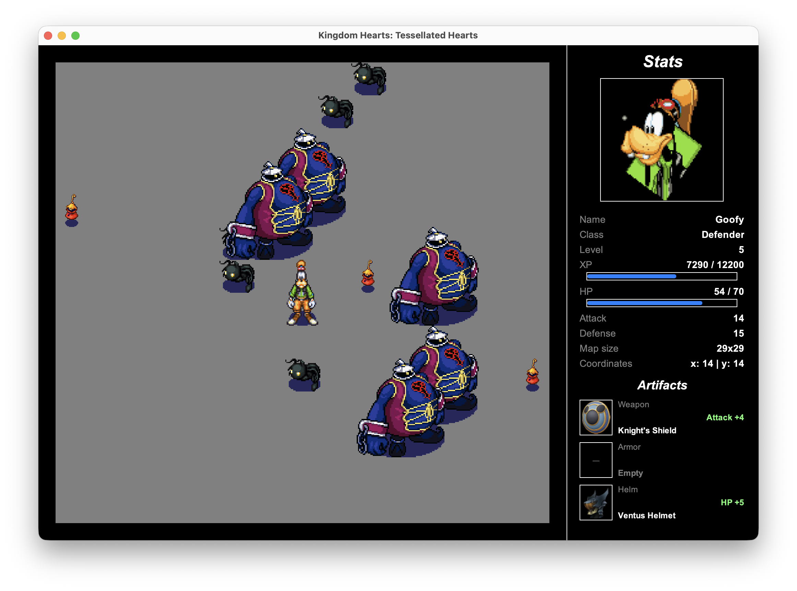

</div>

---

## 📖 Table of contents

- [About](#-about)
- [Screenshots](#-screenshots)
- [Architecture](#-architecture)
- [Getting started](#-getting-started)
- [Controls](#-controls)
- [Gameplay rules](#-gameplay-rules)
- [Heroes, villains & artifacts](#-heroes-villains--artifacts)
- [Validation](#-validation)
- [Persistence](#-persistence)
- [Dependencies](#-dependencies)
- [Project structure](#-project-structure)

---

## 🛡 About

**swingy** is the second Java project of the 42 curriculum. The goal is to build a minimalistic RPG and, above all, to learn how to **abstract the view** from the rest of the application.

> *A group of hipster entrepreneurs wants to launch a new text-based RPG, released in two phases: a console version for hardcore hipsters, then a simple GUI for regular hipsters. They mostly care about the features, but they insist on a clean design.*

The player creates a hero (or picks a saved one), then explores a square map. Reaching any **border** wins the map; stepping on a villain starts a **fight** — or an attempt to **run**. Winning grants XP, levels and sometimes an **artifact** that boosts the hero's stats. Losing kills the hero for good.

This version is themed around *Kingdom Hearts*: Sora, Donald and Goofy against the Heartless.

### Subject requirements

- [x] Java up to the latest LTS, no default package: everything lives in `io.github.zigeuh.swingy.*`
- [x] **Model-View-Controller** architecture
- [x] Automated build with **Maven** — `mvn clean package` produces a runnable `swingy.jar`
- [x] Two launch modes: `console` and `gui`
- [x] Create a hero or select a previously created one, with its full stats displayed
- [x] Map size `(level-1)*5 + 10 - (level%2)`, hero spawns in the center, wins on any border
- [x] Fight / Run (50%) when meeting a villain, battle simulation with a **luck** component
- [x] XP formula `level*1000 + (level-1)²*450`, level-ups, artifact drops (Weapon / Armor / Helm)
- [x] **Annotation-based** user input validation (`jakarta.validation` / Hibernate Validator)
- [x] Heroes persisted between sessions
- [x] **Bonus:** heroes persisted in a **relational database** (H2)
- [x] **Bonus:** **switch between console and GUI at runtime**, without closing the game

---

## 📸 Screenshots

### Swing GUI

| Main menu | Hero creation |
| :---: | :---: |
| 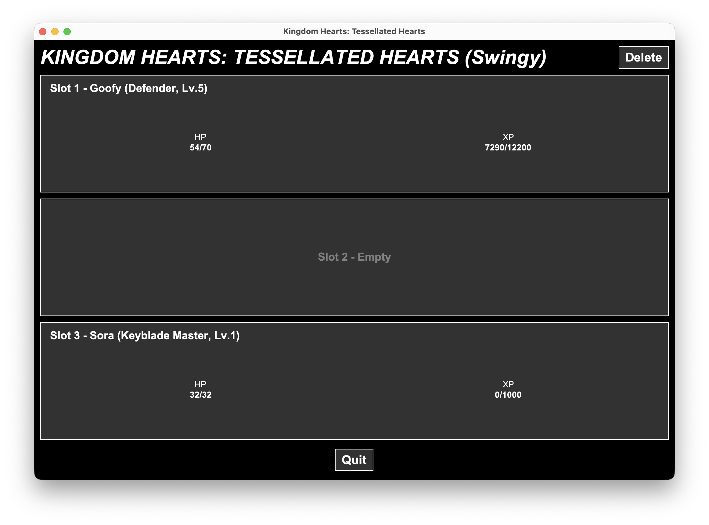 | 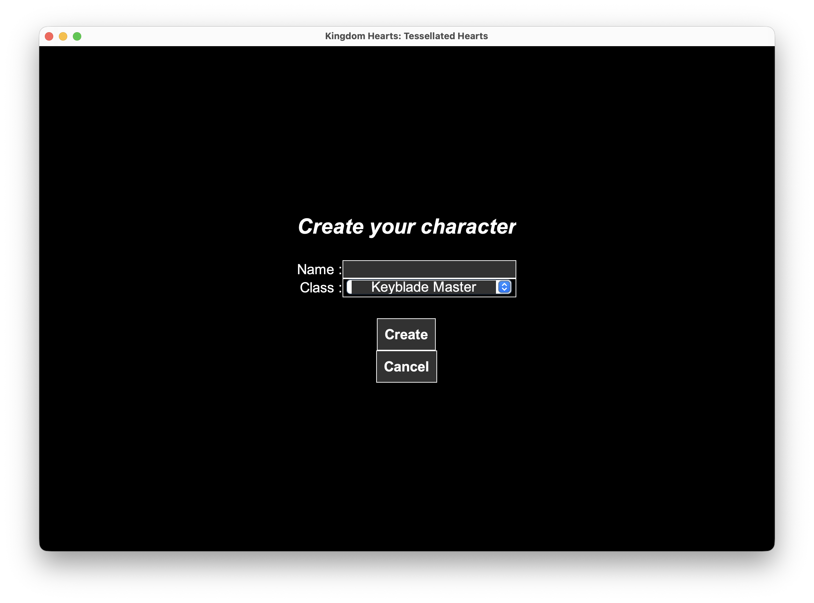 |
| **Exploring the map** | **An enemy is approaching** |
|  | 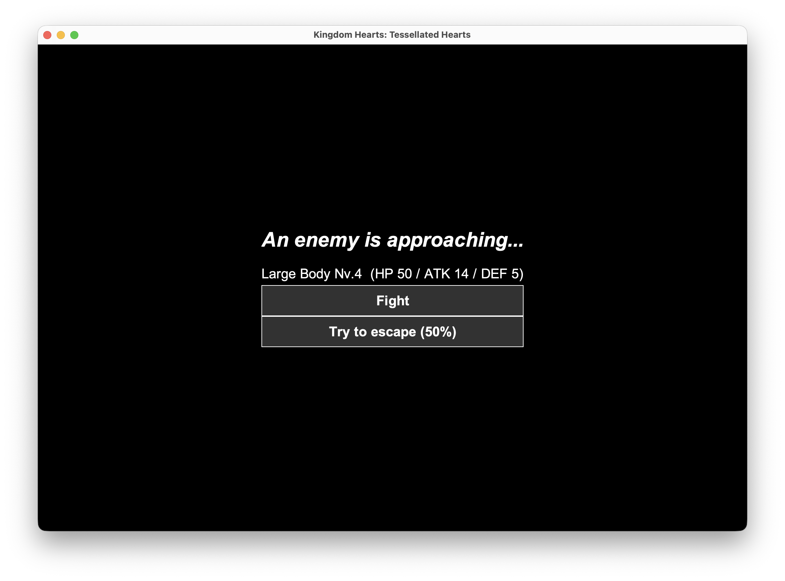 |
| **Battle, round by round** | **Battle recap** |
| 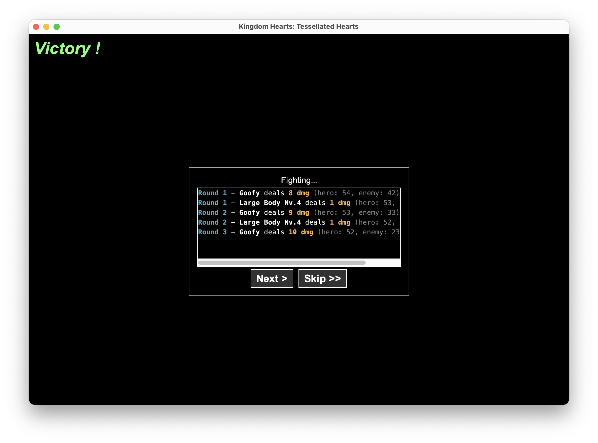 | 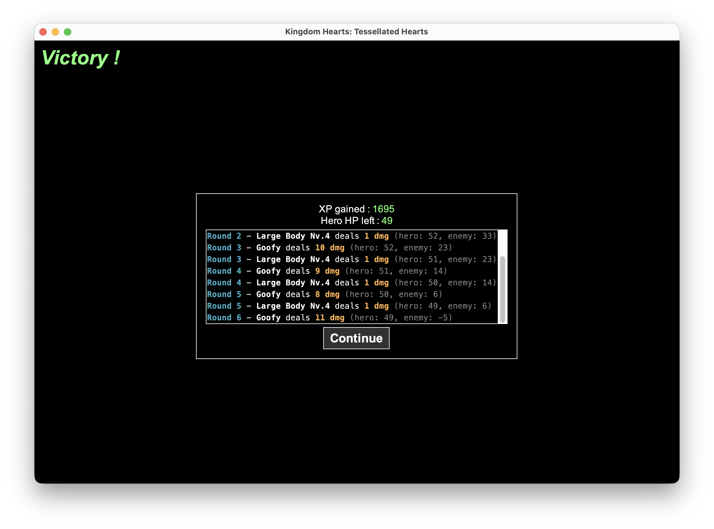 |
| **Loot** | |
| 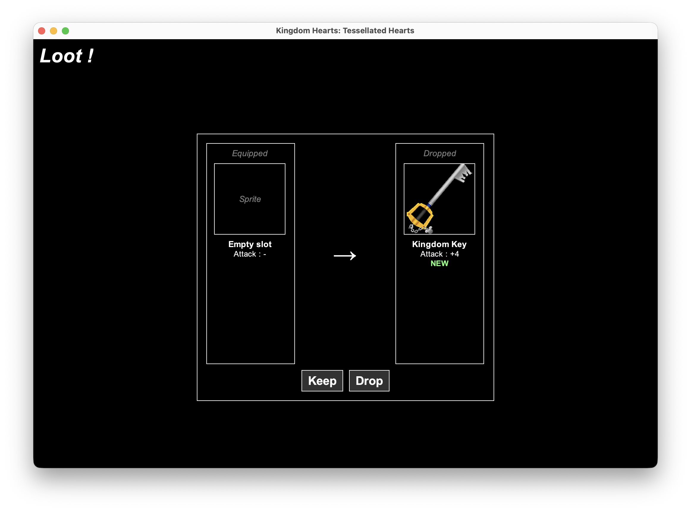 | |

### Console

| Main menu | Exploring the map |
| :---: | :---: |
| 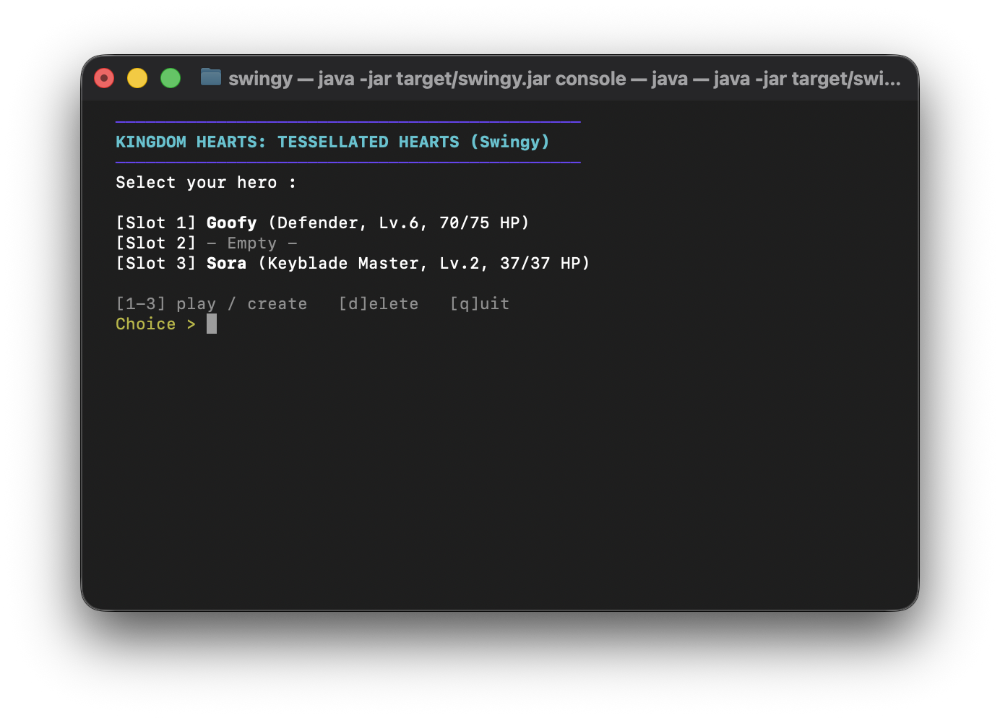 | 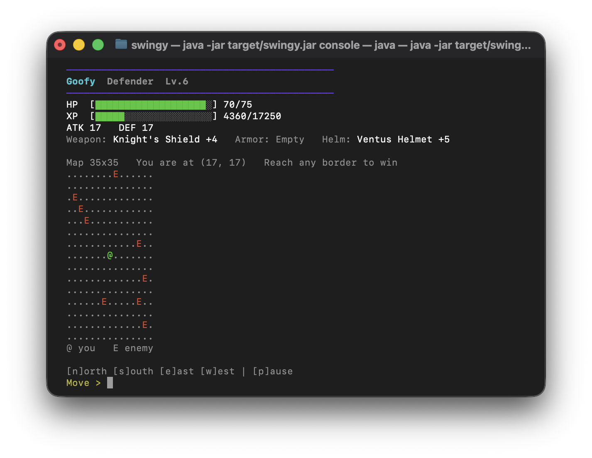 |
| **An enemy is approaching** | **Battle recap** |
| 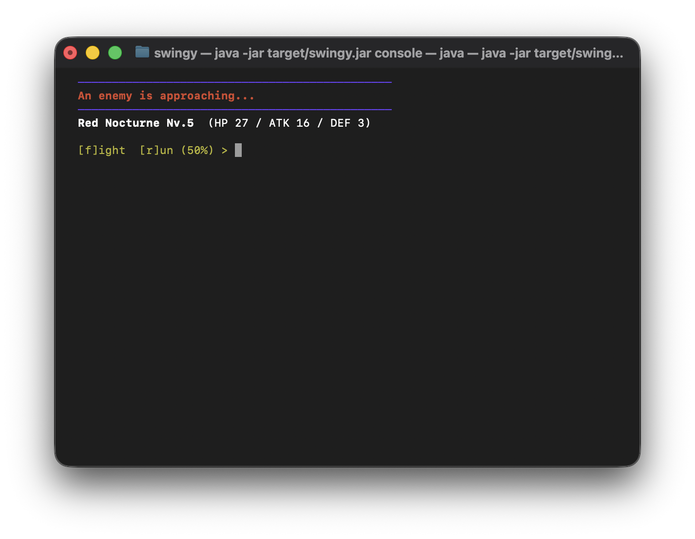 | 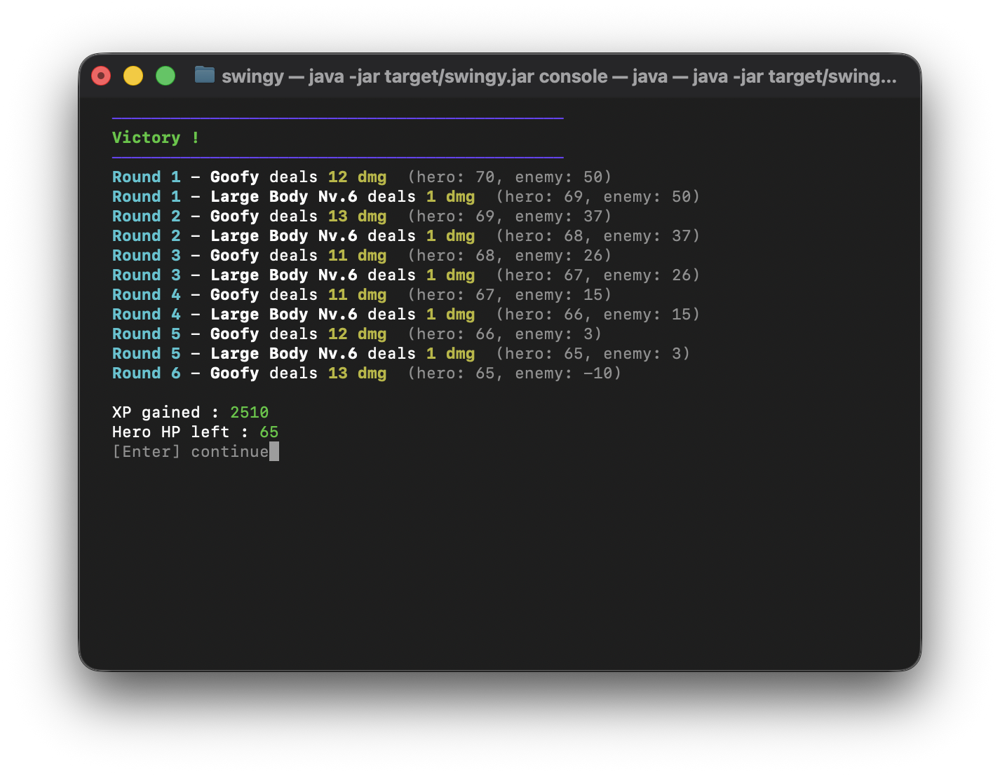 |
| **Loot** | |
| 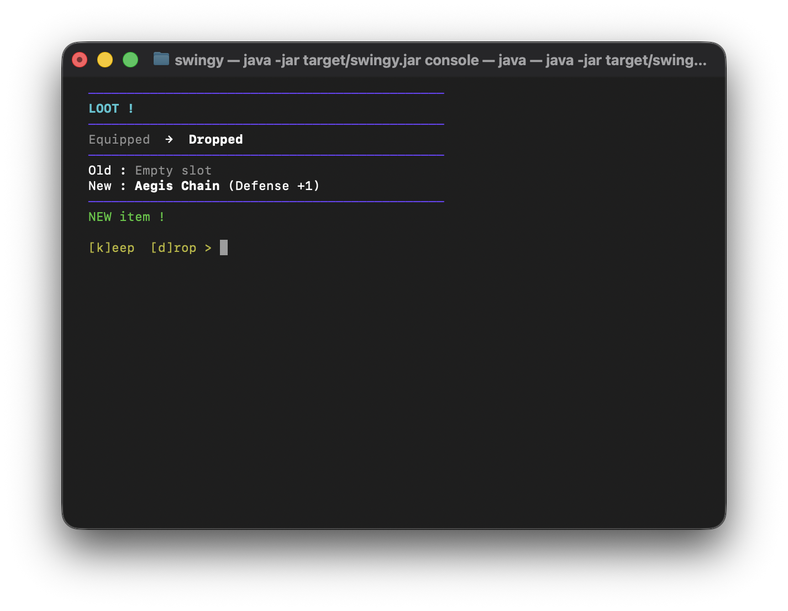 | |

### Runtime view switch

Console → GUI → console, in the middle of a game, without restarting:

<div align="center">

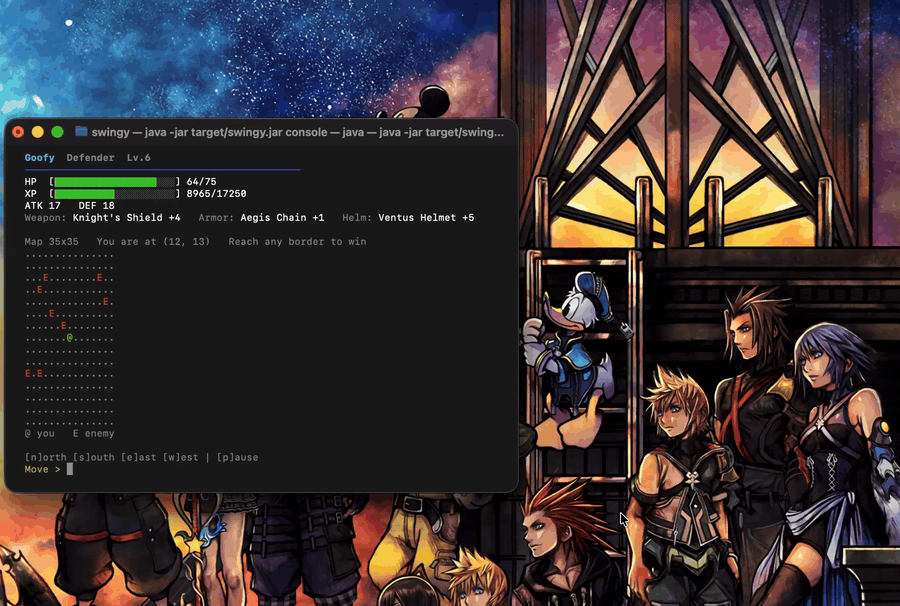

</div>

---

## 🧩 Architecture

The application strictly separates **what the game is** from **how it is displayed**. The model knows nothing about the views, and the controller only talks to the `IView` interface, so both views are interchangeable — even while a game is running.

| Layer | Package | Role |
| --- | --- | --- |
| **Model** | `model.*` | Game state and rules: hero, map, battle, XP, loot, saves. No UI code at all. |
| **View** | `view.console`, `view.swing` | Two implementations of `IView`. They render the state and forward user actions to the controller. |
| **Controller** | `controller` | Receives user actions (`move`, `fight`, `escape`, `keepLoot`, `saveGame`, `switchView`…), updates the model, validates input and tells the current view what to show next. |

### Design patterns

| Pattern | Where | Why |
| --- | --- | --- |
| **MVC** | `Controller` ↔ `IView` ↔ `model` | Required by the subject; makes the view swappable at runtime. |
| **Strategy** | `IView` → `ConsoleView` / `SwingView` | The controller holds an `IView` and doesn't care which one it is. `switchView()` simply closes one and instantiates the other. |
| **Factory** | `EnemyFactory`, `ArtifactFactory` | Create villains scaled to the hero's level and roll random loot, so the rest of the model never instantiates them directly. |
| **Constant-specific methods** | `EnemyType#forLevel` | Each villain type defines its own stat scaling directly in its enum constant. |
| **Immutable value objects** | `Coordinates`, `MoveResult`, `BattleResult`, `RoundLog`, `Artifact` (records) | Results are passed from the model to the views without any risk of being mutated. |

---

## 🚀 Getting started

### Requirements

- **Java 21** or newer (the code uses `Math.clamp`, records and switch expressions)
- **Maven** (`mvn`) available in your terminal, or the one bundled with your IDE

### Build

From the root of the repository, as required by the subject:

```bash
mvn clean package
```

This produces a self-contained runnable jar (dependencies are shaded in) at **`target/swingy.jar`**.

### Run

Console mode:

```bash
java -jar target/swingy.jar console
```

GUI mode:

```bash
java -jar target/swingy.jar gui
```

Without any argument, the game starts in GUI mode. Any other argument prints the usage and exits.

### Reset the saves

The save database lives in your home directory (see [Persistence](#-persistence)):

```bash
rm -rf ~/.swingy
```

---

## 🎮 Controls

### Swing GUI

| Screen | Action |
| --- | --- |
| Main menu | Click a slot to play it (or create a hero in an empty one), **Delete**, **Quit** |
| Map | **← ↑ → ↓** to move, **Esc** to pause |
| Enemy approaching | **Fight** or **Try to escape (50%)** |
| Battle | **Next >** reveals the next round, **Skip >>** shows them all, then **Continue** |
| Loot | **Keep** (equips it, replacing the current one) or **Drop** |
| Pause | **Resume**, **Save**, **Switch view**, **Return to main-menu** |

### Console

| Screen | Input |
| --- | --- |
| Main menu | `1`–`3` play / create, `d` delete, `q` quit |
| Hero creation | Type a name, then pick a class `1`–`3` — `c` cancels |
| Map | `n` north, `s` south, `e` east, `w` west, `p` pause |
| Enemy approaching | `f` fight, `r` run (50%) |
| Battle recap | `Enter` to continue |
| Loot | `k` keep, `d` drop |
| Pause | `r` resume, `s` save, `c` change view, `m` menu |

The console map is a **15×15 viewport centered on the hero**, like the Swing camera:

```text
  Map 15x15   You are at (7, 7)   Reach any border to win
  ...............
  ....E..........
  ...............
  .......@.......
  ..........E....
  @ you   E enemy
```

---

## ⚔️ Gameplay rules

### Map

- The map is a square of size **`(level - 1) * 5 + 10 - (level % 2)`** — a level 1 hero gets a 9×9 map, a level 7 hero a 39×39 map.
- The hero spawns in the **center**. Stepping **outside any border** wins the map: the hero is fully healed and a new map is generated for its current level.
- Each cell (except the center) has a **5%** chance to hold a villain, whose level is the hero's level **±1** (minimum 1).

### Encounter

When the hero steps on a villain:

- **Fight** — the battle is simulated immediately.
- **Run** — **50%** chance to go back to the previous position. Otherwise, the hero is forced to fight.

### Battle

The hero always strikes first, then both sides alternate until one of them reaches 0 HP. Each hit deals:

```text
damage = max(1, attack + luck - defense)        luck ∈ [-2, +2]
```

Every round is logged and displayed in the battle recap. The hero's HP is **not** restored after a fight — it carries over to the next one.

### Victory

- **XP** gained: `enemyLevel * 400 + (enemyAttack + enemyDefense) * 5`
- **Level up** when XP reaches `level * 1000 + (level - 1)² * 450`. Excess XP carries over, and HP is fully restored.

| Level | XP needed |
| :---: | :---: |
| 1 | 1 000 |
| 2 | 2 450 |
| 3 | 4 800 |
| 4 | 8 050 |
| 5 | 12 200 |

- **Loot**: 30% chance to drop an artifact. Its quality depends on the villain's level (see below), and the hero can keep or leave it.

### Defeat

The hero dies and **its save slot is erased**. There is no second chance.

---

## 🧙 Heroes, villains & artifacts

### Hero classes

| Class | Character | HP | Attack | Defense |
| --- | --- | :---: | :---: | :---: |
| **Keyblade Master** | Sora | 32 | 16 | 6 |
| **Wizard** | Donald | 35 | 11 | 8 |
| **Defender** | Goofy | 55 | 7 | 13 |

Stats grow with the level and the equipped artifacts:

```text
max HP  = base HP      + (level / 2) * 5 + helm bonus
attack  = base attack  + (level / 3) * 3 + weapon bonus
defense = base defense + (level / 3) * 2 + armor bonus
```

### Villains

| Heartless | HP | Attack | Defense |
| --- | :---: | :---: | :---: |
| **Shadow** | 18 + 4 × lvl | 9 + lvl | 3 + lvl / 2 |
| **Large Body** | 26 + 6 × lvl | 10 + lvl | 4 + lvl / 3 |
| **Red Nocturne** | 12 + 3 × lvl | 11 + lvl | 2 + lvl / 5 |

### Artifacts

| Type | Effect |
| --- | --- |
| ⚔️ **Weapon** | increases attack — class-specific |
| 🛡 **Armor** | increases defense — any class |
| ⛑ **Helm** | increases max HP — any class |

An artifact can only drop from a villain whose level is at least the artifact's required level. Its bonus is rolled randomly within its range.

| Req. lvl | Keyblade Master | Wizard | Defender | Bonus |
| :---: | --- | --- | --- | :---: |
| 1 | Kingdom Key | Mage's Staff | Knight's Shield | +2 – 4 |
| 4 | Hero's Crest | Comet Staff | Adamant Shield | +4 – 6 |
| 8 | Oathkeeper | Wisdom Wand | Falling Star | +6 – 8 |
| 12 | Oblivion | Rising Dragon | Ogre Shield | +8 – 10 |
| 16 | Ultima Weapon | Save The Queen | Save The King | +10 – 14 |

| Req. lvl | Armor | Bonus | Helm | Bonus |
| :---: | --- | :---: | --- | :---: |
| 1 | Aegis Chain | +1 – 3 | Ventus Helmet | +4 – 6 |
| 4 | Power Band | +3 – 5 | Terra Helmet | +8 – 12 |
| 8 | Buster Band | +5 – 7 | Aqua Helmet | +14 – 18 |
| 12 | Cosmic Belt | +8 – 10 | Vanitas Helmet | +20 – 24 |

---

## ✅ Validation

User input is validated with **annotations** (`jakarta.validation`, implemented by Hibernate Validator) directly on the `Hero` model:

```java
@NotNull(message = "Hero's name can't be null")
@Size(min = 3, max = 12, message = "The length of the hero's name must be between 3 and 12 characters")
private final String name;

@NotNull(message = "Invalid class")
private final HeroClass heroClass;
```

The controller validates the hero before creating it; every violation is sent back to the view, which highlights it (in red in both views) and lets the player try again.

Beyond annotations, no abnormal input can disrupt the game: unknown commands in the console simply loop with an `Invalid choice.` message, invalid slots fall back to the menu, and a closed standard input exits cleanly.

---

## 💾 Persistence

Heroes are stored in an embedded **H2** relational database, in **3 save slots**:

```text
~/.swingy/saves/game.mv.db
```

| Column | Content |
| --- | --- |
| `slot` | Primary key, `0` to `2` |
| `name`, `hero_class` | Hero identity |
| `level`, `xp`, `current_hp` | Progression |
| `weapon`, `armor`, `helm` | Equipped artifact templates |
| `weapon_bonus`, `armor_bonus`, `helm_bonus` | Rolled bonuses |

- The game is **saved manually** from the pause menu or after winning a map, and **automatically** when returning to the menu or quitting.
- A dead hero's slot is deleted.
- If the database can't be opened, the game still runs in memory and warns the player that the session won't be saved.

---

## 📦 Dependencies

The subject forbids external libraries, with two explicit exceptions:

| Library | Why |
| --- | --- |
| [`hibernate-validator`](https://hibernate.org/validator/) | Annotation-based validation (`jakarta.validation` reference implementation), allowed by the mandatory part. |
| [`expressly`](https://github.com/eclipse-ee4j/expressly) | Jakarta Expression Language implementation, required by Hibernate Validator to interpolate constraint messages. |
| [`h2`](https://www.h2database.com/) | Embedded relational database for the **bonus**, so no external server is needed to persist heroes. |

All of them are bundled into `swingy.jar` by the **maven-shade-plugin**.

---

## 📁 Project structure

```text
swingy
├── pom.xml
└── src/main
    ├── java/io/github/zigeuh/swingy
    │   ├── Main.java                   # Entry point: parses console|gui
    │   ├── controller
    │   │   └── Controller.java         # Game flow, validation, saves, view switching
    │   ├── model
    │   │   ├── Game.java               # Current run: hero, map, movement, escape
    │   │   ├── Map.java                # Grid of enemies + hero position
    │   │   ├── Battle.java             # Battle simulation
    │   │   ├── XpTable.java            # Level-up and XP reward formulas
    │   │   ├── SaveManager.java        # H2 persistence
    │   │   ├── SaveSlot.java
    │   │   ├── Coordinates.java, Direction.java
    │   │   ├── MoveResult.java, BattleResult.java, RoundLog.java
    │   │   ├── hero
    │   │   │   ├── Hero.java           # Validated model
    │   │   │   └── HeroClass.java
    │   │   ├── enemy
    │   │   │   ├── Enemy.java
    │   │   │   ├── EnemyType.java
    │   │   │   └── EnemyFactory.java
    │   │   └── artifact
    │   │       ├── Artifact.java
    │   │       ├── ArtifactTemplate.java
    │   │       ├── ArtifactType.java
    │   │       └── ArtifactFactory.java
    │   └── view
    │       ├── IView.java              # Contract shared by both views
    │       ├── ViewType.java
    │       ├── console
    │       │   └── ConsoleView.java    # ANSI-colored terminal UI
    │       └── swing
    │           ├── SwingView.java      # JFrame + CardLayout
    │           └── panel/              # One JPanel per screen
    └── resources/sprites               # Heroes, Heartless and artifacts
```
